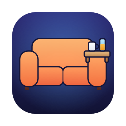
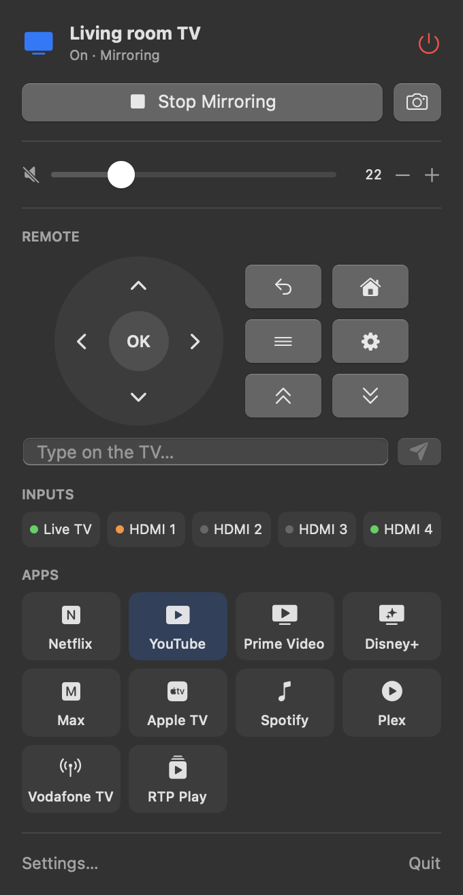
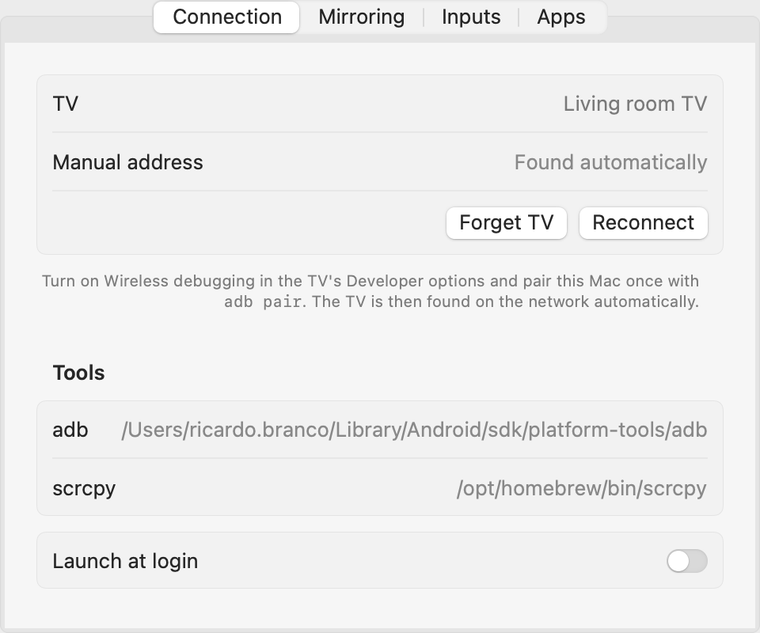
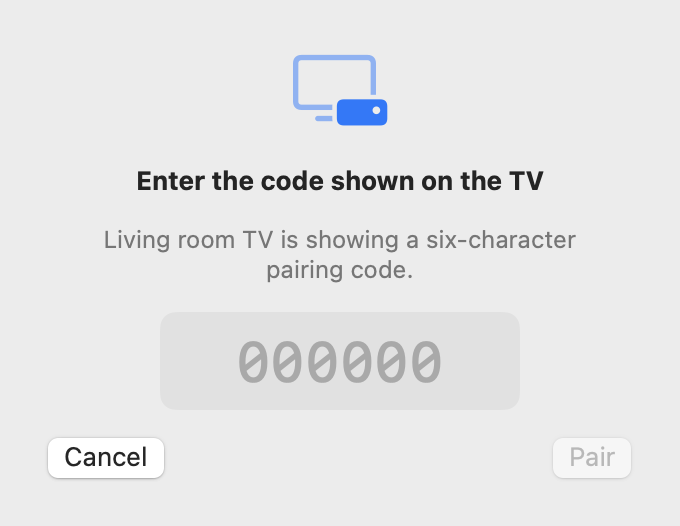

<p align="center">
  
</p>

<h1 align="center">Couchbar</h1>

<p align="center">Your Android TV or Google TV, from the Mac menu bar.</p>

<p align="center">
  <a href="https://github.com/ricardobranco/couchbar/releases"></a>
  <a href="LICENSE"></a>
  <a href="https://paypal.me/ricardobranco92"></a>
</p>

A macOS menu bar app for an Android TV or Google TV. Turn the TV on and off, control volume and playback, type
on the TV from the Mac keyboard, switch inputs, launch apps and mirror the TV screen to a Mac window, all from
the menu bar.

It talks to the TV over wireless ADB and the Android TV Remote protocol, and mirrors the screen with
[scrcpy](https://github.com/Genymobile/scrcpy). Everything stays on your local network: no account, no cloud
service, no telemetry.

<p>
  
  
</p>

## Features

| Where | What |
|---|---|
| Menu bar popup | Power (sleep and wake, Wake-on-LAN when the TV is off the network), volume and mute, now playing with transport controls, D-pad remote that also follows the Mac's arrow keys, a keyboard that edits the TV's selected text field live, input switching (Live TV, HDMI 1–4), favorite apps with the banners they show on the TV |
| Mirroring | The TV screen in a scrcpy window. The Mac keyboard and mouse control the TV, optionally with the TV's sound on the Mac. The popup shows a live preview and the menu bar icon turns blue while mirroring. |
| Screenshots | One click saves a TV screenshot to the Desktop and copies it to the clipboard |
| Settings | Connection (found automatically, or a manual address), keyboard pairing, adb and scrcpy paths, mirroring quality, input names, favorite apps, launch at login |

**Volume.** With the TV's own speakers, or a soundbar that supports CEC absolute volume, you get a slider. A
soundbar that only accepts CEC volume keys gets − / + buttons plus the level it reports.

**Keyboard.** The keyboard uses the Android TV Remote protocol, as the Google Home app does. Pair once in Settings
by entering the code the TV shows; after that, typing edits the selected text field on the TV, accents
included. Until it is paired, text is sent over adb.

**Mirroring limits.** HDMI inputs, Live TV and DRM-protected apps (Netflix and similar) mirror as a black screen,
because Android doesn't capture hardware video layers or protected content. The Google TV home screen and
regular apps mirror normally.

<p>
  
  
</p>

## Compatibility

Built and tested with a TCL 55C845X2 on Google TV 14. Other Android TV and Google TV sets on Android 11 or
later (the first version with wireless debugging) should work: the app uses standard Android commands. Only the
Live TV shortcut and its detection are specific to TCL.

## Requirements

| What | Version or source |
|---|---|
| Mac | macOS 14 Sonoma or later. Developed on Apple silicon. |
| To build | Xcode 16 or later (Swift 6) |
| adb and scrcpy | `brew install android-platform-tools scrcpy` |
| aapt2 (optional) | Android SDK build-tools, for example from Android Studio's SDK Manager. It reads each app's name and banner from the TV; without it, apps show a symbol. |

The app looks for its tools here, and both paths can also be set in Settings:

| Tool | Searched in |
|---|---|
| adb | `$ADB`, `$ANDROID_HOME/platform-tools`, `$ANDROID_SDK_ROOT/platform-tools`, `~/Library/Android/sdk/platform-tools`, `/opt/homebrew/bin`, `/usr/local/bin` |
| scrcpy | `/opt/homebrew/bin`, `/usr/local/bin` |
| aapt2 | The newest `build-tools/<version>` in the SDK next to adb, `$ANDROID_HOME`, `$ANDROID_SDK_ROOT` or `~/Library/Android/sdk` |

## Install

Couchbar is in alpha. Download the latest `Couchbar-<version>.zip` from
[Releases](https://github.com/ricardobranco/couchbar/releases), unzip it and move Couchbar to Applications.

The alpha isn't notarized by Apple yet, so macOS blocks it the first time you open it. To allow it, open System
Settings → Privacy & Security, scroll down to the message about Couchbar, select **Open Anyway** and confirm. You
only need to do this once.

Then install the tools it uses, `brew install android-platform-tools scrcpy`, and follow
[Set up the TV](#set-up-the-tv).

## Build from source

```bash
git clone https://github.com/ricardobranco/couchbar.git
cd couchbar
make install
```

| Command | What it does |
|---|---|
| `make build` | Debug build with SwiftPM |
| `make test` | Unit tests |
| `make app` | Builds a release `build/Couchbar.app` |
| `make run` | Builds the app and opens it |
| `make install` | Builds the app and copies it to `/Applications` |
| `make release` | Builds a universal (Apple silicon and Intel) app and zips it into `dist/` |
| `make clean` | Removes the build folders |
| `make icon` | Redraws the app icon from `scripts/make-icon.swift` into `Support/AppIcon.icns` and `docs/icon.png` |

`scripts/build-app.sh` signs the app with an Apple Development certificate for the team in `TEAM_ID`. If no
matching certificate is found, it signs ad hoc. Ad hoc works on your own Mac. To sign with your own team or a
specific identity:

```bash
TEAM_ID=YOURTEAMID make install
```

```bash
SIGN_IDENTITY="Apple Development: Your Name (XXXXXXXXXX)" make install
```

Keep the same signature between builds: macOS ties the Local Network permission to the app's signature, and
asks again when it changes.

## Set up the TV

1. On the TV, turn on Developer options: Settings → System → About, then select **Android TV OS build** seven
   times.
2. In Settings → System → Developer options, turn on **Wireless debugging**. Select it, then **Pair device with
   pairing code**.
3. On the Mac, pair once with the address and code the TV shows:

   ```bash
   adb pair 192.168.1.20:37000
   ```

4. Open Couchbar. When macOS asks to let it find devices on your local network, select **Allow**. The TV is
   then found automatically and remembered by its serial number, even when its IP address changes.
5. Optional: in Settings → Connection → Keyboard, select **Pair…** and enter the code shown on the TV.

## Troubleshooting

| Problem | What to check |
|---|---|
| "No TV found" | Wireless debugging is on and the TV is on the same network as the Mac. In System Settings → Privacy & Security → Local Network, Couchbar is allowed. |
| "No TV found" while Android Studio is open | All apps share one adb server, and macOS applies the Local Network permission of the app that started it. Quit Android Studio, run `adb kill-server`, and reopen Couchbar. Or allow Android Studio in Local Network too. |
| The mirror window is black | The TV is showing HDMI, Live TV or a DRM-protected app (see Mirroring limits above). |
| The keyboard doesn't type | In Settings, unpair the keyboard and pair it again. |
| scrcpy errors | `~/Library/Logs/Couchbar/scrcpy.log` |

## Your data

| What | Where |
|---|---|
| Settings | The app's user defaults (`dev.ricardobranco.couchbar`) |
| Keyboard pairing certificate | `~/Library/Application Support/Couchbar/remote` (Unpair deletes it) |
| App names and banners read from the TV | `~/Library/Caches/Couchbar/apps` |
| scrcpy log | `~/Library/Logs/Couchbar/scrcpy.log` |

## Development

Open `Package.swift` in Xcode for SwiftUI previews of the popup and Settings.

| Task | Command |
|---|---|
| Read-only checks against a real TV | `TV_LIVE_TESTS=1 swift test --filter LiveTVTests` |
| Re-render the images in this README | `swift build && .build/debug/Couchbar --render-previews docs/previews --artwork ~/Library/Caches/Couchbar/apps` |

The images use the sample data in `Sources/Couchbar/Previews.swift`, not a live TV. `--artwork` adds the app banners the app has cached from your TV; leave it
out to show symbols instead.

| Path | Contents |
|---|---|
| `Sources/CouchbarCore` | adb process runner, device discovery, TV client, dumpsys parsers, app artwork, scrcpy arguments, Wake-on-LAN |
| `Sources/CouchbarCore/Remote` | Android TV Remote protocol v2: TLS client certificate, pairing, keyboard session, protobuf encoding |
| `Sources/Couchbar` | SwiftUI menu bar app: controller, scrcpy session, popup and Settings views |
| `Tests/CouchbarCoreTests` | Parser and protocol tests from real TV output, opt-in live TV tests |
| `Support` | Bundle metadata (`LSUIElement`: menu bar only, no Dock icon) and the app icon |
| `scripts` | App bundle build and signing, icon drawing |

## How it was made

Couchbar was built with [Claude Code](https://claude.com/claude-code). Claude wrote most of the code, tests and docs;
I chose the features, reviewed the changes and tested everything on a TCL Google TV. Commits made with Claude
carry a `Co-Authored-By` line.

## Credits

Couchbar runs these tools as separate programs; it doesn't include their code.

| Project | Used for | License |
|---|---|---|
| [scrcpy](https://github.com/Genymobile/scrcpy) by Genymobile and Romain Vimont | Screen mirroring | Apache 2.0 |
| [Android SDK Platform-Tools](https://developer.android.com/tools/releases/platform-tools) (adb) and build-tools (aapt2), from the Android Open Source Project | Talking to the TV, reading app names and banners | Apache 2.0 |

The Swift implementation of the Android TV Remote protocol was written using these projects as protocol
references:

| Project | |
|---|---|
| [androidtvremote2](https://github.com/tronikos/androidtvremote2) by tronikos | Python client for protocol v2, Apache 2.0 |
| [androidtv-remote](https://github.com/louis49/androidtv-remote) by louis49 | Node.js client for protocol v2 |
| [Aymkdn's protocol notes](https://github.com/Aymkdn/assistant-freebox-cloud/wiki/Google-TV-(aka-Android-TV)-Remote-Control-(v2)) | Description of the v2 messages |

Icons inside the app are [SF Symbols](https://developer.apple.com/sf-symbols/) by Apple. The app icon is drawn in code
for this project and is covered by the MIT license.

## Support

Couchbar is free. If it saves you a trip to the remote, you can [buy me a coffee](https://paypal.me/ricardobranco92).

## License

[MIT](LICENSE) © 2026 Ricardo Branco

Couchbar is not affiliated with or endorsed by Google, TCL or Genymobile. Android, Android TV and Google TV are
trademarks of Google LLC. Other product names are trademarks of their owners.
