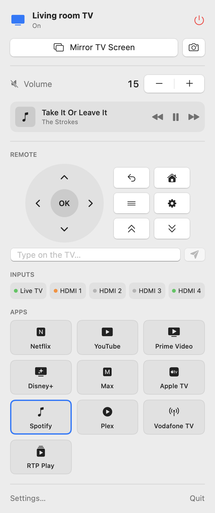
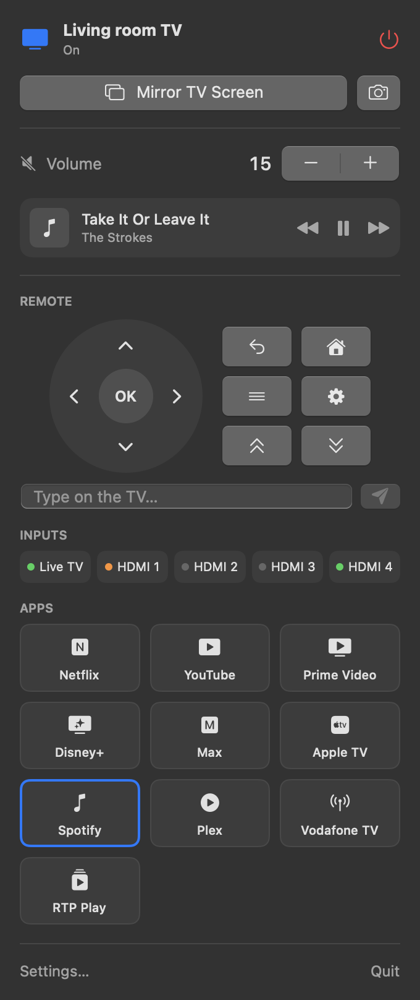

# TV Companion

A macOS menu bar companion for an Android TV / Google TV, built for the TCL 55C845X2 (Google TV 14).
It talks to the TV over wireless ADB and mirrors the TV screen to the Mac with [scrcpy](https://github.com/Genymobile/scrcpy).

<p>
  
  
</p>

## Features

| Where | What |
|---|---|
| Menu bar popup | Power (sleep / wake, Wake-on-LAN when offline), TV screen mirroring, TV screenshot to Desktop and clipboard, volume and mute, now playing with transport controls, D-pad remote with keyboard arrows, typing text on the TV, input switching (Live TV, HDMI 1–4), favorite app launcher |
| Mirror window | scrcpy window with the TV screen; the Mac keyboard and mouse control the TV, optional TV sound on the Mac |
| Settings | Connection (auto-discovered or manual address), adb and scrcpy paths, mirroring quality, input names, favorite apps, launch at login |

Volume is a slider when the TV can set an exact level: its own speakers, or a soundbar with CEC absolute volume.
A soundbar that only takes CEC volume keys gets − / + buttons and the level it reports.

HDMI inputs, Live TV and DRM-protected apps (Netflix and similar) mirror as black: Android can't capture
hardware video planes or secure surfaces. The Google TV UI and regular apps mirror normally.

## Requirements

- macOS 14 or later, Apple silicon
- Android platform-tools (`adb`) and scrcpy: `brew install scrcpy android-platform-tools`
- The TV on the same network with Wireless debugging on (Settings → System → Developer options),
  paired once with `adb pair <ip>:<port>`. The TV is then found by mDNS and remembered by its serial number.

## Build

```bash
make test   # unit tests
make run    # builds build/TV Companion.app and opens it
make install  # copies the app to /Applications
```

`scripts/build-app.sh` signs with the Apple Development identity of `TEAM_ID` (or `SIGN_IDENTITY`), and falls
back to an ad-hoc signature. Open `Package.swift` in Xcode for SwiftUI previews of the popup and Settings.

Read-only checks against a real TV: `TV_LIVE_TESTS=1 swift test --filter LiveTVTests`.

Preview images: `swift build && .build/debug/TVCompanion --render-previews docs/previews`.

## Layout

| Path | Contents |
|---|---|
| `Sources/TVCompanionCore` | adb process runner, device discovery, TV client, dumpsys parsers, scrcpy arguments, Wake-on-LAN |
| `Sources/TVCompanion` | SwiftUI menu bar app: controller, scrcpy session, popup and Settings views |
| `Tests/TVCompanionCoreTests` | Parser tests from real TV output, opt-in live TV test |
| `Support/Info.plist` | Bundle metadata (`LSUIElement`: menu bar only, no Dock icon) |
